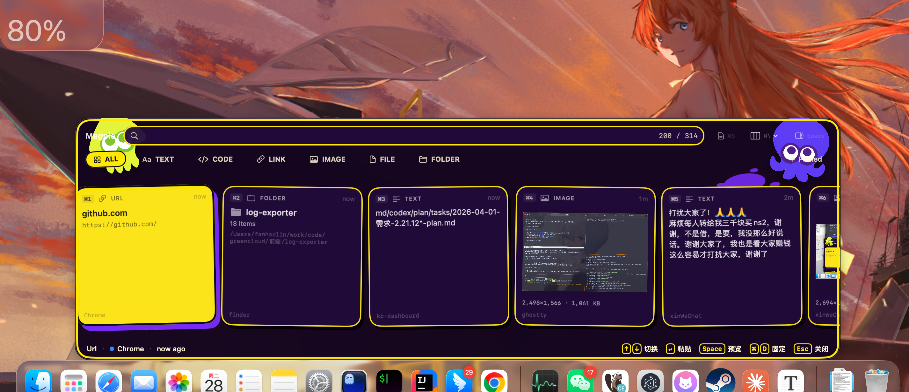

<div align="center">


# Magpie

**本地优先、键盘驱动的 macOS 剪切板管理器**
*A local-first, keyboard-driven clipboard manager for macOS*

[](LICENSE)
[](#)
[](#)
[](#)
[](#)

像喜鹊收集闪亮的小东西一样 — 自动收下你复制的一切，按一下键召出来，再按一下贴出去。

</div>

---

## ✨ 截图

> **⌘P** 召出面板，⌘1–⌘9 / ↩ 一键贴回前台 app。Splat 主题（黄绿章鱼吉祥物 + 紫色墨点装饰）让你忘不掉它。

<p align="center">
  
  <br/>
  <em>Splat dark：粗黄外框 + 紫色面板 + 章鱼角落装饰</em>
</p>

<p align="center">
  
  <br/>
  <em>Stripe 布局 + Detail Pane（按 Space 召出，霓虹高亮选中卡片）</em>
</p>

---

## 为什么用 Magpie

设计目标是**替代 Maccy + Deck**，把"剪切板历史"和"代码片段"做在同一个面板里：

- 🔒 **纯本地** —— SQLite 落盘，永不联网，永不上传，永不分析
- ⌨️ **键盘是一等公民** —— 任何鼠标可达功能都有快捷键
- 🎨 **6 种内容类型** —— text / code / url / image / file / folder 各有专属预览
- 🪟 **3 种布局** —— Stripe（横向卡片） / Stack（紧凑列表） / Grid（瓷砖墙）
- 🔍 **FTS5 全文搜索** —— 支持 `type:code app:vscode tag:design` 这种 key:value 语法
- 📌 **Pin / Snippets / Queue Mode** —— 钉常用、存模板、批量贴
- 📸 **截图与标注** —— `⌘J` 框选屏幕，调整选区并添加箭头、文字、马赛克；复制到历史或保存 PNG
- 🔐 **Touch ID 隐私门** —— 召出面板前指纹解锁（可选）
- 🚫 **Secret 自动跳过** —— API key / Bearer token / JWT / OTP 不入库
- 🎭 **5 种主题** —— mono / graphite / blue / olive 走系统简约；**Splat** 走 Splatoon 灵感的紫黄装饰风
- 🌐 **中英文界面** —— Settings 一键切换

---

## 📦 下载安装

### 推荐：直接装 DMG

下载最新 Release：[`dist/Magpie-0.3.0.dmg`](dist/Magpie-0.3.0.dmg)（4.4 MB）

```bash
# 拖进 /Applications
open dist/Magpie-0.3.0.dmg
```

> **首次启动**：macOS 会因为 ad-hoc 签名提示"无法验证开发者"。
> 在 Finder 里**右键 .app → 打开**确认一次即可，之后双击就能开。
> v1.0 会换正式 Apple Developer ID 签名，届时双击直接开。

### 给予权限

Magpie 需要以下权限才能完整工作：

| 权限 | 用途 | 怎么开 |
|---|---|---|
| **辅助功能** | 模拟 ⌘V 把 clip 贴回前台 app | 系统设置 → 隐私与安全性 → 辅助功能 → 添加 Magpie |
| **输入监控**（可选） | `;sig` 之类的片段触发器自动展开 | 系统设置 → 隐私与安全性 → 输入监控 → 添加 Magpie；并在 Magpie 设置里打开 *Auto-expand snippet shortcuts* |
| **屏幕与系统音频录制**（可选） | 使用 `⌘J` 截图与标注 | 首次按 `⌘J` 时按系统提示授权；授权后按提示重启 Magpie |

第一次启动如果没批准辅助功能，Magpie 会自动弹系统对话框引导。

---

## ⌨️ 快捷键

### 全局

| 快捷键 | 行为 |
|---|---|
| `⌘P` | 召出 / 收起 主面板 |
| `⌘J` | 打开截图编辑器；完成后复制或保存 PNG |
| `Esc` | 收回面板（搜索框非空时先清搜索） |

### 截图编辑器

按 `⌘J` 后拖动框选，拖动选区内部移动，拖动边缘或八个控制点调整大小。工具栏跟随选区，悬停按钮可查看名称和快捷键。

标注默认红色。选择矩形、椭圆、箭头、画笔或文字后会展开色板，点击色块直接选色，白色外框表示当前颜色；也可点击工具栏的颜色按钮收起或展开色板。同一次截图切换工具保留选色，换色只影响后续标注，新一次截图恢复红色。

| 快捷键 | 行为 |
|---|---|
| `V` | 调整选区；点击标注可选中、移动、缩放 |
| `R` / `O` / `A` | 矩形 / 椭圆 / 箭头 |
| `P` / `T` / `M` / `E` | 画笔 / 文字 / 马赛克 / 表情 |
| `X` / `L` | 提取文字 / 翻译文字 |
| `D` / `N` / `G` | 一键打码 / 贴图 / 长截图 |
| `⇧⌘S` | 打开系统分享 |
| `⇧` + 拖动 | 正方形、圆形或 45° 箭头 |
| `C` / `[` / `]` | 切换颜色 / 减细 / 加粗 |
| `⌘A` | 选择当前整屏 |
| 方向键 / `⇧` + 方向键 | 移动选区 1 / 10 点 |
| `⌥` + 方向键 | 调整选区右边缘或上边缘；可叠加 `⇧` |
| `⌘Z` / `⇧⌘Z` | 撤销 / 重做；`Delete` 删除选中标注，无选中项时撤销 |
| `↩` / `⌘C` | 复制截图并进入 Magpie 图片历史 |
| `⌘S` | 保存 PNG；取消保存对话框会回到编辑器 |
| `Esc` / 右键 | Esc 清除标注选择或取消；右键依次返回选项、选区与退出 |

文字输入中，回车确认，Shift+回车换行，Esc 放弃当前编辑；双击已有文字可继续修改。选择工具下双击选区可复制。保存不改剪贴板，取消不产生历史记录。每个显示器可独立选择，图片保留原像素密度，暂不支持跨屏拼接。

选区前可单击鼠标下的窗口，也可拖动自定义区域；放大镜显示标准 sRGB 色值，未框选时 `⌘C` 复制色值。选中标注后可移动、缩放、改色和删除，所有这些操作支持撤销。工具选项提供线宽、字号、填充、马赛克画笔/框选模式与表情大小，表情输入框接受其他完整表情。

文字识别在本机执行，结果可编辑、复制。翻译使用 macOS 15+ 的系统本地能力，缺少语言包时只有点击“下载语言包并翻译”才请求系统下载；Apple 可能收集使用语言等指标，不包含原文和译文。Magpie 不接入云端 OCR 或翻译接口。一键打码检测人脸、姓名以及电话、邮箱等候选区域，完成后需检查并手动补涂遗漏。

贴图窗口保持悬浮，支持拖动或方向键移动、滚轮或 `⌘+` / `⌘-` 缩放、`⌘0` 恢复大小、双击/Esc 关闭，以及复制、保存、系统分享。分享由用户主动选择系统服务，Magpie 不读取微信联系人或自动发消息。

长截图请框选可滚动内容，按 `G` 后手动缓慢向下滚动；工具显示预览与已拼接高度，支持暂停、Enter 完成并复制、Esc 返回编辑。重叠不足时会提示稍向上滚回并放慢，达到 30000 像素高或 4000 万总像素时暂停；固定头尾和窗口边缘在重叠区处理，持续动画、视频及复杂固定侧栏可能需要重新选择区域。已有标注不会进入实时长截图，开始前会提示确认。

### 面板内

| 快捷键 | 行为 |
|---|---|
| `↑` `↓` `←` `→` | 切换焦点卡片 |
| `↩` | 粘贴 focused clip |
| `⌘1` … `⌘9` | 直接粘贴第 1–9 张 |
| `Space` | 开 / 关 Detail Pane（搜索为空时） |
| `⌘O` | 把 focused clip 在独立大窗口里放大查看 |
| `⌘D` | Pin / Unpin focused clip |
| `⌘\` | 切换布局（Stripe → Stack → Grid） |
| `⌘S` | 开 / 关 Snippets 抽屉 |
| `⌘Q` | 进入 / 退出 Queue Mode |
| `⌘,` | 打开 Settings |

---

## 🎨 主题

5 种 flavor，每种都有 light/dark 两套 token：

| Flavor | 风格 | 用途 |
|---|---|---|
| **Mono** | 纯灰 | 极简党，跟 Finder 一个气质 |
| **Graphite** | 石墨灰 | 比 Mono 多一点点层次 |
| **Blue** | 海军蓝 | 经典 Aqua |
| **Olive** | 橄榄绿 | 自然柔和 |
| **Splat** ⭐ | Splatoon 致敬 — 黄绿章鱼 + 紫色墨点 | 装饰主题，看一眼就忘不掉 |

Settings → 通用 → 风格 切换。还能调毛玻璃强度和**面板透明度**（0.6–1.0）。

Settings → 通用 → **界面材质** 可切换“液态玻璃 / 毛玻璃”，默认液态玻璃，支持所有布局及深浅主题。macOS 26+ 配合 Xcode 26+ 构建时使用原生 `NSGlassEffectView` 与搜索控件 `glassEffect`；macOS 14/15 或旧 Xcode 使用兼容毛玻璃和柔和高光。原生玻璃的虚化由系统管理。启用系统“减少透明度”时使用不透明背景，保留原有材质偏好。

---

## 🔐 隐私

Magpie 设计上就是**永不联网**：

- ❌ 没有任何分析 / 遥测 / 崩溃上报代码
- ❌ 没有云同步、登录、账号系统
- ❌ Settings 里的 *Send analytics* 开关**永远不可启用**（占位提示文案而已）
- ✅ 所有数据落 `~/Library/Application Support/Magpie/clips.sqlite`
- ✅ 启动可选 Touch ID 解锁
- ✅ Secret 模式自动跳过 8 类敏感字符串（API key / Bearer / GitHub token / AWS / JWT / OTP 等）
- ✅ 用户可指定"忽略的应用"（这些 app 复制的内容永不入库）
- ✅ History retention 设置（保留 N 天 / 限制条数 / 一键清空）

> v1.0 会加 **SQLCipher 加密本地数据库**，密钥存 macOS Keychain。

---

## 🛠️ 从源码构建

需要：

- macOS 14 (Sonoma) 或更高
- 完整 Xcode 15+（仅 Command Line Tools 不够）
- [XcodeGen](https://github.com/yonaskolb/XcodeGen)（用 `brew install xcodegen` 安装）

```bash
git clone https://github.com/sanwan99/magpie.git
cd magpie
python3 Scripts/setup-local-signing.py --create # 首次创建本机专用签名身份
xcodegen generate                              # 从 project.yml 生成工程
Scripts/install-release.sh                     # 构建、备份、安装并重启
```

本机开发构建固定使用登录钥匙串中的 `Magpie Local Development` 证书，私钥不进入仓库。首次签名时，在 macOS 钥匙串弹窗中授权 `codesign` 使用该密钥；后续构建复用同一身份。证书缺失或不可用时构建会停止，不退回临时签名。

安装脚本将旧版备份到 `~/Library/Application Support/Magpie/Backups/`，校验新版本签名后替换并重启。它不自动重置权限。从旧临时签名迁移时，可明确执行 `Scripts/install-release.sh --migrate-screen-permission`，只清理 Magpie 的旧屏幕录制授权，再由用户为固定签名版本授权一次；通常更新不使用此参数。

截图权限尚不可用时，每次启动最多自动申请一次，同一未授权状态只显示一次帮助提示。需要重新打开设置时，使用菜单栏“屏幕录制权限…”。

不要从 `build/Build/Products/Debug/Magpie.app` 启动 Magpie。启动器会索引项目内 Debug app，导致同时出现 `Magpie` 和 `Magpie Debug` 两个入口。

依赖（SPM 自动拉取）：

- [GRDB.swift](https://github.com/groue/GRDB.swift) — SQLite ORM + FTS5

`⌘P` / `⌘J` 全局热键直接使用系统 Carbon `RegisterEventHotKey`，不依赖第三方热键包。

---

## 🧪 测试

```bash
Scripts/test.sh
```

测试脚本使用工作区外的 `/private/tmp/magpie-derived` 作为 DerivedData，并复用 `/private/tmp/magpie-source-packages` 包缓存；结束后会清理临时 Debug app，避免启动器出现第二个 Magpie 入口。

XCTest 覆盖以下模块：

- `SecretDetectorTests` — 27 个（8 种 secret 模式 + 阴性样本）
- `SnippetRepositoryTests` — 10 个（CRUD + 触发器索引）
- `HistoryReaperTests` — 8 个（retention + maxItems + clear all）
- `ScreenshotCoordinatorTests` — 19 个（权限、会话、面板恢复、复制与保存分流）
- `ScreenshotEditorTests` — 14 个编辑/渲染测试，另有 1 个需屏幕录制权限的实机捕获测试；覆盖选区边界、Retina 裁剪、马赛克、文字和鼠标/键盘事件
- `ScreenshotAdvancedTests` — 编辑动作、表情、OCR、取色、拼接边界与真实滚动测试窗口；离线翻译测试仅在语言包已安装时运行
- 其他模块 — 70 个（ClipDetector / SearchQueryParser / HotkeyCenter 等）

---

## 🗺️ Roadmap

| 版本 | 状态 | 范围 |
|---|---|---|
| v0.1 | ✅ 已发布 | 剪切板监听、⌘P 面板、Stripe 布局、↵/双击粘贴、4 种类型 |
| v0.2 | ✅ 已发布 | 搜索（FTS5 + key:value 语法）、类型过滤、Pin、Stack & Grid、Detail Pane、Settings |
| v0.3 | ✅ 已发布 | Image 类型、Snippets 抽屉 + 编辑器、History/Privacy/Queue Mode、ColorScheme-aware Splat dark |
| **v0.3-d 系列** | ✅ 已发布 | 装饰元素（squid + 墨点）、霓虹选中态、面板透明度、放大预览窗口（⌘O）、菜单栏图标 + sleep/wake/Space 切换 hotkey 自愈、粘贴去重 upsert、AX 权限自检 |
| **v1.0** | 进行中 | `⌘J` 截图与标注、Sparkle EdDSA 自动更新、SQLCipher 加密、PasteToast 动画、ClipPreview hover 过渡、Apple Developer ID 签名、Homebrew Cask、公开仓库 |
| Later | — | 正则搜索、URL 跟踪参数清理、CLI 工具、`;sig` CGEventTap 升级、第三方 Sync 插件接口 |

---

## 📁 项目结构

```
magpie/
├── Magpie.xcodeproj/           # Xcode 工程（xcodegen 生成）
├── project.yml                 # XcodeGen 项目定义
├── Sources/Magpie/
│   ├── App/                    # AppDelegate、StatusItemController（菜单栏）
│   ├── Panel/                  # PanelController、PanelWindow（NSPanel 主面板）
│   ├── Clipboard/              # ClipboardWatcher、ClipDetector（类型识别）
│   ├── Storage/                # GRDB schema + ClipRepository（FTS5 + upsert 去重）
│   ├── Paste/                  # FrontmostTracker + Paster（CGEvent ⌘V 模拟）
│   ├── Hotkey/                 # HotkeyCenter（Carbon RegisterEventHotKey）
│   ├── Screenshot/             # 屏幕捕获、选区、标注、PNG 导出与剪贴板路由
│   ├── Snippets/               # 片段管理 + ;sig 自动展开
│   ├── Privacy/                # SecretDetector + BiometricGate (Touch ID)
│   ├── History/                # HistoryReaper（retention + 清理）
│   ├── Settings/               # SettingsStore + 4 个 Pane（中英文 i18n）
│   ├── Theme/                  # AppTheme + Flavor + SplatDecorations（自绘装饰）
│   └── UI/                     # ClipPreview、Stripe/Stack/Grid、DetailPane、ExpandedPreviewWindow
├── Resources/
│   ├── Info.plist
│   └── Assets.xcassets/        # AppIcon、SquidYellow、SquidPurple
├── Tests/MagpieTests/          # XCTest 单元测试
├── prototype/                  # 原始 React/JSX 视觉原型 + 13 节产品规格说明（设计依据，仅参考）
├── md/                         # 任务计划 / changelog / ADR / 月度台账（软链到私人 notes 仓）
└── dist/                       # DMG release 产物
```

---

## 🤝 Contributing

Pull requests welcome. 详见 [CONTRIBUTING.md](CONTRIBUTING.md)。

提 PR 前请先看 [`prototype/剪切板工具/Magpie 原型说明.html`](prototype/) — 那是 13 节完整产品规格的事实标准，任何交互/键位/视觉/命名隐喻的争议都以它为准。

发现安全问题？请按 [SECURITY.md](SECURITY.md) 流程提交。

---

## 📜 License

[MIT](LICENSE) © 2026 sanwan99 and Magpie contributors

---

## 🙏 致谢

- 灵感来自 [Maccy](https://github.com/p0deje/Maccy)、[Raycast Clipboard](https://www.raycast.com)、Deck
- Splat 主题致敬任天堂 *Splatoon* — Inkling / Octoling 的喷射美学
