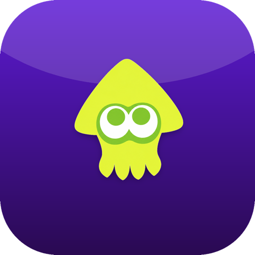
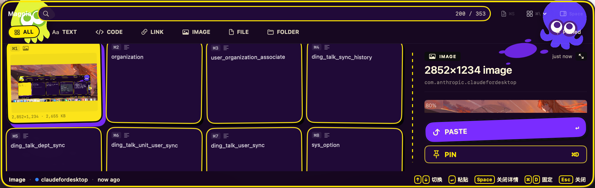

<div align="center">


# Magpie

**Keep what you copy. Find it when you need it.**

A local-first, keyboard-driven clipboard and screenshot companion for macOS.
Search your history, reuse snippets, and paste back into your working window.

[简体中文](README.md) · **English**

[](#build-from-source)
[](LICENSE)
[](https://github.com/sanwan99/magpie/releases)
[](https://github.com/sanwan99/magpie/actions/workflows/ci.yml)
</div>

## Screenshots



An existing, real application screenshot from this repository. Newly added settings are not pictured.

## Features

- **Typed history:** text, code, links, images, files and folders, with dedicated previews. File clips reference original paths; Magpie does not duplicate those files.
- **Search and organization:** FTS5 search with a CJK substring fallback, quoted phrases, `type:code` and `app:vscode` filters; pins, notes and retention controls.
- **Keyboard workflow:** `⌘P` opens the panel, `Return` or `⌘1–9` pastes an item. Panel and capture shortcuts can be customized. Queue Mode supports successive pastes.
- **Snippets:** reusable text templates with optional typed-trigger expansion. Expansion pauses when privacy lock is enabled, so it cannot bypass panel authentication.
- **Screenshots:** `⌘J` opens region/window selection, annotations, text, mosaic, undo, PNG export, OCR, pinned images and manual scrolling capture. Review automatic redaction for missed areas.
- **Native interface:** Stripe, Stack and Grid layouts; five themes; Chinese and English. Native glass on macOS 26, compatible materials on older systems.

The panel displays up to 200 matching items by default. Non-pinned image, file and folder histories each have an independent 50-item cap. Pins are exempt from automatic retention.

## Download and install

**Source Alpha: no public application Release is currently available.**

Future distributions will appear on [GitHub Releases](https://github.com/sanwan99/magpie/releases). There is no downloadable `dist/*.dmg` in this repository, and GitHub source archives are not application installers. For a normal download-and-open installation, wait for a Developer ID-signed, notarized distribution.

Source builds use ad-hoc signing by default, without a paid developer account or certificate setup. They are not notarized public releases, and macOS permission grants may change after rebuilding.

Do not disable Gatekeeper or SIP, or remove quarantine attributes as a routine installation step. Check the source, signature and release instructions if macOS blocks an application.

For a future signed distribution, `Scripts/install-release.sh /path/to/Magpie.app --team-id TEAMID_FROM_RELEASE` verifies Developer ID, Gatekeeper and signer continuity, backs up an existing application and attempts rollback if startup verification fails. The expected team identifier must come from independently verified release instructions; it is required for a first public installation. The script does not download packages, create certificates or reset permissions. This optional script requires Python 3. A future DMG should also support ordinary Finder drag-and-drop installation. A full public-install test still requires an actual signed distribution.

## First run

1. Open Magpie from the menu bar. It does not normally appear in the Dock.
2. Copy ordinary text, then press `⌘P`. Clipboard contents from before launch are not automatically imported.
3. Select a record and press Return. Grant Accessibility for automatic paste, or copy the record and paste manually.
4. Set retention and ignored applications in History; enable the optional authentication lock in Privacy.
5. Change conflicting global shortcuts in Shortcuts. Carbon registration conflicts are reported; also check macOS reserved shortcuts in System Settings.

| Permission / capability | Purpose | Required? |
| --- | --- | --- |
| Accessibility | Automatic paste and optional snippet expansion | Required for automatic paste, not history browsing; currently requested on launch and may be declined |
| Input Monitoring | Optional global snippet trigger observation; actual authorization depends on macOS | Not needed for basic history |
| Screen Recording | Explicit screenshots and scrolling capture | Required for capture; Magpie does not record audio |
| System authentication | Touch ID or macOS account password | Only with privacy lock enabled |

Automatic paste checks process identity, focused window, clipboard ownership and permission again before sending. It cancels when focus changes or a window cannot be identified reliably. The content remains on the system clipboard for manual paste.

## Keyboard shortcuts

| Scope | Default | Action |
| --- | --- | --- |
| Global | `⌘P` / `⌘J` | Toggle panel / capture; both configurable |
| Panel | Return / `⌘1–9` | Paste selection / numbered item |
| Panel | Arrows / Space / `⌘O` | Navigate / details / expanded preview |
| Panel | `⌘D` / `⌘S` / `⌘Q` | Pin / snippets drawer / Queue Mode |
| Panel | `⌘\` / `⌘,` / Escape | Cycle layout / settings / cancel cascade |
| Capture | `V R O A P T M E` | Select, rectangle, ellipse, arrow, pen, text, mosaic, sticker |
| Capture | `X L D N G` | OCR, translation, redact, pin, scrolling capture |
| Capture | `⌘Z` / `⇧⌘Z` | Undo / redo |
| Capture | Return / `⌘C` / `⌘S` / Escape | Copy / copy / save PNG / cancel |

See the [capture guide](docs/SCREENSHOTS.md). Capture operates per display; cross-display stitching is not supported.

## Privacy and security

- **Storage:** history, FTS data and snippets are in `~/Library/Application Support/Magpie/clips.sqlite`; cached PNGs are in `images/` beside it. Preferences use UserDefaults. Installer application backups are in `Backups/`.
- **Not encrypted:** this is ordinary SQLite, without SQLCipher. File permissions restrict other accounts, not other authorized processes running as you or administrators. The panel lock is not encryption.
- **Filtering:** Concealed/Transient markers are always respected. Optional heuristics detect common tokens, private keys and contextual OTPs, with both false negatives and false positives. They cannot identify arbitrary passwords or secrets in images. Ignored-app attribution uses the observed foreground app and is not an equivalent substitute for privacy markers.
- **Lock lifetime:** opening a hidden panel requires fresh system authentication. Hiding, sleeping, screen lock, session changes and restart relock it. Failure, cancellation and unavailable authentication policies do not grant access. Changing the lock setting also requires fresh authentication.
- **Network boundaries:** the application currently has no telemetry, account or cloud sync implementation, and no cloud OCR/translation integration. OCR runs on-device; macOS translation may download language packs after user action. Apple controls its system services. User-selected sharing services and default applications handle sharing and links. The optional developer script `generate-theme-mascots.py` calls an external image API; it is not part of normal application execution.
- **Deletion:** Clear History removes clips, pins, FTS entries and managed image files. It preserves snippets, preferences, the system clipboard, application backups and original user files. Logical deletion cannot guarantee removal from SQLite WAL/free pages, filesystem snapshots, Time Machine or other backups.

See [SECURITY.md](SECURITY.md). Never include real credentials or private clipboard content in reports.

## Build from source

Runtime: **macOS 14+**. The current source and complete test suite require **full Xcode 26+ with the macOS 26 SDK**. Command Line Tools alone are insufficient. Translation needs macOS 15+; native glass needs macOS 26+. Swift uses the 5.9 language mode. [GRDB.swift](https://github.com/groue/GRDB.swift) is the only SPM dependency.

```bash
git clone https://github.com/sanwan99/magpie.git
cd magpie
xcodebuild -version
Scripts/build-local.sh
```

The Xcode project is committed; XcodeGen is unnecessary for an ordinary build. Swift Package Manager fetches GRDB on the first build. The script prints the app path and an explicit local installation command. Use `--local-build` only for source you have reviewed and built yourself.

To use an existing stable local identity:

```bash
MAGPIE_CODE_SIGN_IDENTITY='Your local signing identity' Scripts/build-local.sh
```

`python3 Scripts/setup-local-signing.py --create` is an optional developer utility that changes the local keychain. It is not required by the default build, public installation or CI. Public distributions require separate Developer ID signing and notarization.

After changing `project.yml`, regenerate and commit the Xcode project:

```bash
brew install xcodegen
xcodegen generate
```

## Development and tests

```bash
Scripts/test.sh
python3 -m unittest discover -s Tests/Tooling -v
python3 Scripts/check-privacy-logs.py
python3 Scripts/check-doc-links.py
python3 Scripts/benchmark-storage.py
```

The test script uses temporary DerivedData and retains `.xcresult` under `.build/`. macOS CI builds the Release configuration and runs the complete XCTest target without personal certificates. Existing live-capture/translation tests report environmental skips when permission or language packs are absent; skips are not passes. Mocked installer tests do not establish real Gatekeeper behavior.

[Review record](docs/review/2026-10-18.md) · [Performance methodology](docs/PERFORMANCE.md) · [Release and manual acceptance](docs/RELEASING.md)

## Roadmap

- **Current Source Alpha:** history, search, snippets, themes, screenshot editing and the privacy/stability fixes in this branch.
- **Proposed `v0.4.0-alpha.1`:** an initial prerelease after native permission, signing, notarization and installation/upgrade acceptance. This tag has not been published.
- **Future evaluation:** encrypted local storage, signed automatic updates, CJK search scalability and more resilient scrolling capture. These are not shipped features or dated promises.

## Contributing

Read [CONTRIBUTING.md](CONTRIBUTING.md). Keep changes focused and verifiable. `project.yml` defines the project; current code and tests define implemented behavior. `prototype/` is historical design reference. Include the problem, behavior changes, verification and limitations in your PR.

Magpie keeps its SwiftUI + AppKit + GRDB + SQLite stack. No cross-platform shell or application rewrite is planned.

## License

[MIT](LICENSE) © 2026 sanwan99 and Magpie contributors.

The Splat theme takes inspiration from ink-game aesthetics. This project is not affiliated with or endorsed by Nintendo. Asset and screenshot redistribution rights still need review before public binary distribution.
